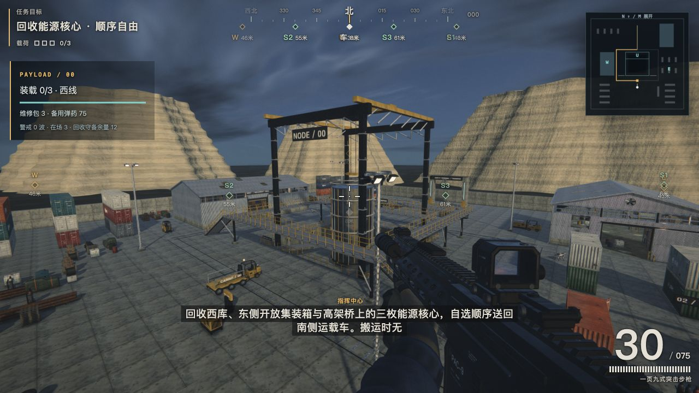

# BigGamePage · 一页大作

**Big games. One page.**

[Play online](https://subtlecooooder.github.io/BigGamePage/?lang=en) · [GitHub](https://github.com/subtlecooooder/BigGamePage) · [简体中文](README.zh-CN.md) · [Install & use](docs/getting-started.en.md) · [Documentation](docs/index.md) · [Provenance & licensing](docs/licensing.en.md)

Detailed procedural 3D scenes, combat and missions in one HTML file. BigGamePage combines an **AI authoring Skill, a pinned game foundation, recipes, and build/validation tools**. Each exported game is strictly below **2,000,000 bytes** and loads no external models, textures, fonts, audio, CDN code or APIs.

**This is a source preview, not a fully licensed open-source release.** The Three.js MIT notice is retained. Redistribution permission for the inherited game and derived assets remains unverified; a license for the project's new contributions has not been selected. Read [LICENSE-STATUS.md](LICENSE-STATUS.md) before publishing. This repository includes inherited code and screenshots; it must not be described as entirely MIT-licensed.



*In-engine capture from 2026-11-14. An inspection-camera image does not prove a player reached that viewpoint.*

## Play online

Open the [four-game arcade](https://subtlecooooder.github.io/BigGamePage/?lang=en) and choose a game. No installation or repository download is needed. Use a WebGL2-capable desktop browser with keyboard/mouse. Links start muted; enable sound on the landing page before launching if desired.

All four games include **English and Simplified Chinese**. A fresh direct launch follows your browser language (English fallback). Change **Language** on the title screen or pause with **Esc / P** to switch during a mission without restarting. Manual choices are remembered; choose **Browser language** to return to automatic selection. Explicit `?lang=en`, `?lang=zh` or `?lang=auto` links override a saved choice. Both languages are embedded in the single HTML.

## Run locally

Get the project:

```sh
git clone https://github.com/subtlecooooder/BigGamePage.git
cd BigGamePage
```

Use **Python 3.9+** and a desktop browser with WebGL2. Builds use only the Python standard library. No npm install or API key is required. Run these commands from the repository root:

```sh
python3 scripts/build.py
python3 -m http.server 8000 --bind 127.0.0.1 --directory site
```

Open **http://127.0.0.1:8000/**. Demo links start muted by default; enable sound on the landing page before launching if desired. `site/games/` is generated and Git-ignored. GitHub Actions builds all four games and deploys the complete `site/` directory to Pages.

Each exported HTML is independently movable. Its `.build.json` sidecar is verification metadata, not a runtime dependency. Local HTTP has been tested; `file://` cold starts, browser-offline mode, mobile touch and the audio mix have not been fully validated.

## Four examples, two layout families

| Game / recipe | Layout and mechanics | HTML size |
|---|---|---:|
| [零号中转站 / Switchyard Zero · `switchyard-zero`](https://subtlecooooder.github.io/BigGamePage/games/switchyard-zero.html?noaudio=1) | Independent freight hub; unordered core recovery, heat/cooling, route choice, escort and finite repairs | 1,537,350 B |
| [夜港无声 / Silent Harbor · `night-harbor`](https://subtlecooooder.github.io/BigGamePage/games/night-harbor.html?noaudio=1) | Original harbor layout; alert management, infiltration, devices and extraction | 1,526,863 B |
| [月面余氧 / Lunar Reserve · `selene-repair`](https://subtlecooooder.github.io/BigGamePage/games/selene-repair.html?noaudio=1) | Original harbor layout; reduced gravity, oxygen and repairs | 1,526,977 B |
| [地底九号 / Bunker Nine · `bunker-09`](https://subtlecooooder.github.io/BigGamePage/games/bunker-09.html?noaudio=1) | Original harbor layout; fuse recovery, power, flashlight and escape | 1,527,063 B |

The last three share the original layout. Switchyard Zero replaces both the map and mission controller. Detailed machine dogs, drones, enterable warehouses and open containers are retained. Export size was not achieved by replacing those models with simplified approximations.

Controls: WASD move, mouse aim, left click fire, R reload, hold E interact, Shift sprint, C crouch, Space jump, P pause. Switchyard adds Q to drop a core and M for the map; Bunker uses L for the flashlight. Follow the game's fallback-view instructions if pointer lock is unavailable. The landing page, guides and in-game UI support both English and Chinese.

## Install the Skill in Codex

```sh
python3 scripts/install_skill.py --dest ~/.agents/skills
```

This copies the **complete** `skills/big-game-page/` directory, validates its resources, and refuses to overwrite an existing installation. A project-local `.agents/skills` destination is also supported. See the [installation guide](docs/getting-started.en.md).

Invoke in Codex:

```text
$big-game-page
Starting from Switchyard Zero, create a distinct repair-and-escape level.
Define its new layout, player decisions, failure conditions and resource tradeoffs first.
Preserve detailed models and enterable buildings. Export one HTML under 2,000,000 bytes,
with no external runtime resources. Test silently with normal enemies and damage.
Provide actual-input route evidence, screenshots, build hashes and failed attempts.
```

The Skill reuses existing assets and implementation patterns. New maps and genres still require authored modules and new acceptance routes; editing JSON alone cannot invent mechanics. An AI coding agent may incur service fees. The games themselves make no model calls.

## Repository layout

```text
skills/big-game-page/   Complete Skill, pinned foundation, recipes and build scripts
scripts/               Build-all, installation and repository checks
site/                  Bilingual demo page and local captures; games/ is generated
docs/                  Setup, architecture, testing, release and licensing guides
docs/provenance/       Source commit, file hashes and unresolved rights inventory
evidence/              Dated gameplay and repository-preparation evidence
.github/               Technical checks, Pages deployment, issue and PR templates
```

## Validate and contribute

```sh
python3 scripts/check.py
python3 scripts/check.py --release
```

The first checks reproducibility, size, an isolated Skill install/build, local links and rejection of a modified foundation. It also checks JavaScript syntax when Node.js is available. The second checks rights records only; **exit code 2 is currently expected** because release blockers remain. Passing technical checks does not establish permission.

All four deployed HTTPS games completed fresh, muted input-driven routes on 2026-11-16, with normal enemies and damage. The hosted files match local builds byte for byte. See [testing](docs/testing.md) for current logs and screenshots, plus the separate 2026-11-14 thermal recovery evidence and validation limits.

Read [contributing](CONTRIBUTING.md), [architecture](docs/architecture.md), and the [release guide](docs/release.md). This repository is a source preview; public visibility does not resolve permission gaps. GitHub Pages hosts the playable demos; no Release download package has been published.

## Credits

The foundation evolved from a user-supplied Chinese HTML file. Code comparison and the [source mirror](https://github.com/realcodebear/saltline-fable-5.2) support its connection to **Saltline**. The mirror credits **Felix Rieseberg** with the original experiment and links his presentation and Claude Artifact. A mirror is not permission from the rights holder, and the intervening Chinese modifications have not been fully traced.

[Detailed provenance](docs/licensing.en.md) · [Third-party notices](THIRD_PARTY_NOTICES.md) · [Three.js MIT](skills/big-game-page/assets/THREE-LICENSE.txt)
