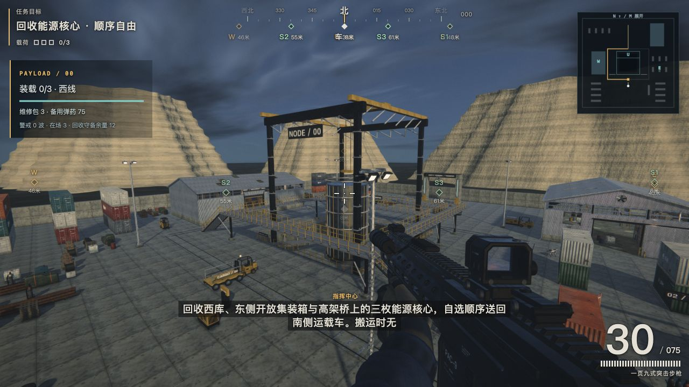

# BigGamePage · 一页大作

**Big games. One page.**

[在线试玩](https://subtlecooooder.github.io/BigGamePage/?lang=zh) · [GitHub](https://github.com/subtlecooooder/BigGamePage) · [English](README.md) · [安装与使用](docs/getting-started.md) · [文档目录](docs/index.md) · [来源与授权](docs/licensing.md)

把精细的程序化 3D 场景、战斗与任务装进一个 HTML。BigGamePage 是一套 **AI 制作 Skill + 固定游戏底座 + 配方 + 构建与验收工具**。每款导出的游戏严格小于 **2,000,000 字节**，运行不加载外部模型、贴图、字体、音频、CDN 或 API。

**当前是源码预览，尚未获得整包开源许可。** Three.js 的 MIT 许可已保留；继承游戏及衍生素材的再分发许可仍待确认，项目新增部分的开源许可证也待维护者确定。请先读 [LICENSE-STATUS.md](LICENSE-STATUS.md)。本仓库包含继承代码和截图，不能直接据此宣称“全项目 MIT”。



*2026-11-14 实机渲染截图，场景检查机位；不是玩家抵达该机位的证明。*

## 在线试玩

打开 [四款游戏演示站](https://subtlecooooder.github.io/BigGamePage/?lang=zh)，选择游戏即可开始，无需安装或下载项目。推荐支持 WebGL2 的桌面浏览器与键鼠；试玩链接默认静音，可在首页打开声音后再进入。

四款游戏均支持 **简体中文和英文**。首次直接打开时跟随浏览器语言，其他语言回退为英文。开始页可选语言，游玩中按 **Esc / P** 暂停后也可切换，无需重开任务。手动选择会记住；选“跟随浏览器”恢复自动识别。`?lang=en`、`?lang=zh` 和 `?lang=auto` 可以显式覆盖已保存的选择。两套文案均封装于同一个 HTML。

## 本地运行

先获取项目：

```sh
git clone https://github.com/subtlecooooder/BigGamePage.git
cd BigGamePage
```

需要 **Python 3.9+** 和支持 WebGL2 的桌面浏览器。构建只使用 Python 标准库，不需要 npm 或 API Key。以下命令在仓库根目录运行：

```sh
python3 scripts/build.py
python3 -m http.server 8000 --bind 127.0.0.1 --directory site
```

打开 **http://127.0.0.1:8000/**。演示入口默认静音；页面里的声音开关可在进入游戏前启用声音。`site/games/` 是构建产物，不提交 Git；GitHub Actions 会构建四份游戏并将整个 `site/` 发布到 Pages。

导出 HTML 可以独立移动，旁边的 `.build.json` 仅用于校验，不参与运行。已测试本地 HTTP；`file://` 冷启动、浏览器离线模式、手机触控和音频混音尚未完整验收。

## 四个样例，两个布局家族

| 游戏 / 配方 | 地图与玩法 | HTML 大小 |
|---|---|---:|
| [零号中转站 / `switchyard-zero`](https://subtlecooooder.github.io/BigGamePage/games/switchyard-zero.html?noaudio=1) | 独立环形货运枢纽；自由顺序搬运核心、过热与冷却、选线护送和有限维修 | 1,537,232 B |
| [夜港无声 / `night-harbor`](https://subtlecooooder.github.io/BigGamePage/games/night-harbor.html?noaudio=1) | 原港区布局；警戒、潜入、设备交互与撤离 | 1,526,745 B |
| [月面余氧 / `selene-repair`](https://subtlecooooder.github.io/BigGamePage/games/selene-repair.html?noaudio=1) | 原港区布局；低重力移动、氧气管理和抢修 | 1,526,859 B |
| [地底九号 / `bunker-09`](https://subtlecooooder.github.io/BigGamePage/games/bunker-09.html?noaudio=1) | 原港区布局；保险芯、电力恢复、手电与逃生 | 1,526,945 B |

后三款共享底层布局，并非三张独立地图。零号中转站重做地图与任务控制器。完整机器狗与无人机模型、可进入仓库和集装箱沿用精细底座；没有通过缩减模型来满足体积限制。

WASD 移动，鼠标瞄准，左键射击，R 换弹，按住 E 交互，Shift 冲刺，C 蹲伏，Space 跳跃，P 暂停。中转站另有 Q 放下核心、M 地图；地下版 L 手电。浏览器无法锁定鼠标时，按游戏提示使用备用视角控制。

## 把 Skill 装进 Codex

```sh
python3 scripts/install_skill.py --dest ~/.agents/skills
```

脚本复制 **整个** `skills/big-game-page/`，校验资源完整性，遇到同名目录会停止，不覆盖旧版本。也可只安装到某个项目的 `.agents/skills`。详见 [完整安装说明](docs/getting-started.md)。

在 Codex 中调用：

```text
$big-game-page
以零号中转站为基础，设计一个“抢修后撤离”的独立关卡。
先说明新的地图布局、玩家决策、失败条件和资源取舍。
保留精细模型与可进入建筑，输出单 HTML、严格小于 2,000,000 字节、无外部资源。
保持正常敌人与伤害，静音测试真实操作路线；提供截图、构建哈希和失败记录。
```

Skill 能复用现有资产与实现方式。新地图、新类型仍需要编写对应模块和验收路线；仅改 JSON 不会自动创造新机制。使用 AI 编程代理可能产生服务费用，游戏本身没有模型调用。

## 仓库结构

```text
skills/big-game-page/   完整可安装 Skill、固定底座、配方、模块与构建器
scripts/               四款构建、安装和仓库校验入口
site/                  中英文演示首页、本地截图；games/ 由构建生成
docs/                  使用、架构、测试、发布和授权说明
docs/provenance/       来源提交、文件哈希、授权问题清单
evidence/              按日期保留的实测与本轮仓库整理证据
.github/               技术校验、Pages 部署工作流、问题与 PR 模板
```

## 验证与参与

```sh
python3 scripts/check.py
python3 scripts/check.py --release
```

第一条检查重复构建、体积、独立 Skill 安装后构建、链接和底座篡改拒绝；有 Node.js 时也检查导出脚本语法。第二条只检查授权记录，**当前预期退出码为 2**，列出未解决项；技术通过不等于许可齐备。

2026-11-16 已在部署后的 HTTPS 页面重新静音跑通四款游戏，保持正常敌人和伤害；线上文件与本地构建逐字节一致。本轮日志、截图、验证边界，以及单独保留的 2026-11-14 热管理证据，见 [测试说明](docs/testing.md)。

欢迎先阅读 [贡献指南](CONTRIBUTING.md) 与 [架构](docs/architecture.md)。仓库按源码预览提供；公开可见不代表授权问题已解决。GitHub Pages 提供在线试玩；Release 下载包尚未发布。部署与许可记录见 [发布说明](docs/release.md)。

## 原作与依赖

当前底座从用户提供的中文 HTML 演变而来。源码比对与[来源镜像](https://github.com/realcodebear/saltline-fable-5.2)支持其与 **Saltline** 的关系；镜像 README 将原始实验归于 **Felix Rieseberg**，并给出原作者展示和 Claude Artifact 链接。镜像不等于权利人授权，中文修改的来源也尚未完整核清。

[完整来源记录](docs/licensing.md) · [第三方声明](THIRD_PARTY_NOTICES.md) · [Three.js MIT](skills/big-game-page/assets/THREE-LICENSE.txt)
