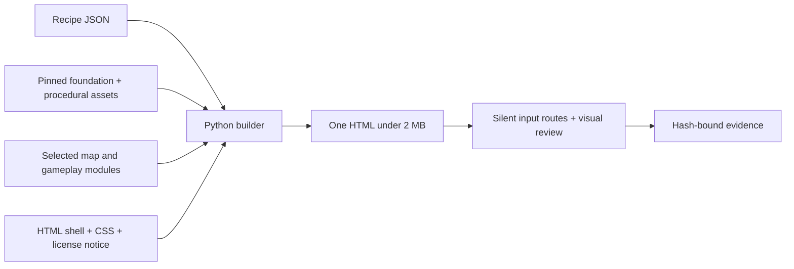

# Architecture / 架构

BigGamePage packages a pinned industrial FPS with authored extensions. It is not a general engine extracted into stable public APIs. 当前版本围绕固定底座复用；适配层仍依赖原引擎的私有符号。

| Layer | Files | Responsibility |
|---|---|---|
| Foundation | `skills/big-game-page/assets/runtime/foundation.js` | Embedded Three.js, render loop, procedural assets, combat and original level factories; pinned by SHA-256 |
| Adapter | `adapter.js` | Maps inherited symbols into the `BGP` boundary |
| Legacy extensions | `devices.js`, `climbing.js`, `worlds.js`, `missions.js` | Supplies, EMP/doors, traversal, three environments and mission modifiers around the original layout |
| Independent archetype | `freight-map.js`, `freight-game.js`, `freight-style.css` | Replaces map and mission controller; owns navigation, recovery, heat, loading, escort, repairs and reset |
| Localization | `i18n.js`, `i18n-style.css`, `assets/locales/en.json`, recipe `locales.en` | Browser-aware Chinese/English presentation, reversible switching, embedded copy and responsive English layout |
| Acceptance | `qa.js`, `freight-qa.js` | Visible input drivers and reports; inspection-camera views kept separate |
| Packaging | Skill `scripts/build.py`, root `scripts/build.py` | Validate recipes/hash, inline all dependencies and notices, enforce size, write manifests |
| Showcase | `site/` | Static bilingual landing page; default-muted links to generated games |

`world=freight` selects the freight modules. The other three recipes select the legacy modules. Different narrative or colors do not create a new layout. Development files may be modular; the final HTML has no sibling-file dependency.

Both archetypes install localization last. The builder embeds the English catalog and recipe translations, and patches the HUD's display boundary so complete strings are translated before typewriter animation slices them. DOM text is updated without replacing buttons or their listeners. The title/pause selector changes presentation without restarting the mission; `lang=en|zh|auto` overrides saved preferences, which otherwise override browser-language selection. Raw QA records and scene textures remain source data. No runtime translation service is used.

A new map must move geometry, collision, navigation, interiors and labels together. A new loop must own start/pause/reset/win/loss and recovery from failure. Changing an asset factory or foundational symbol requires re-baselining and new gameplay/visual evidence.

Reference geometry: dog full rig **17,348 triangles**, hash `56cdfa8c`; drone full rig **13,790 triangles**, hash `aabcf30a`. These counts include effect planes. Asset-only figures are 17,344 and 13,788. Counts and hashes supplement visual review; they do not measure playability.

更详细的初始化顺序、适配接口与地图约定见 [Skill architecture](../skills/big-game-page/references/architecture.md)。配方限制见 [recipe contract](../skills/big-game-page/references/recipe-contract.md)。
